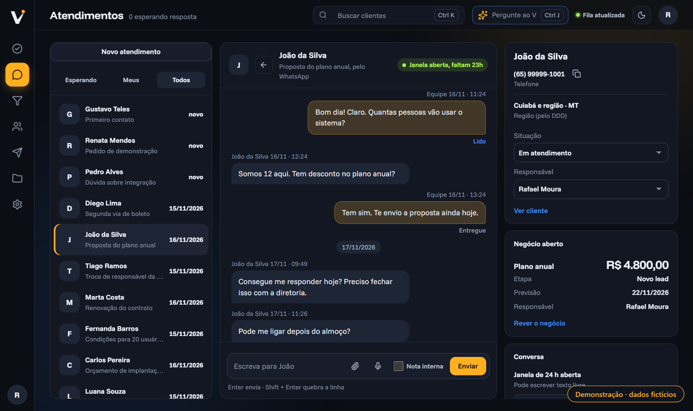
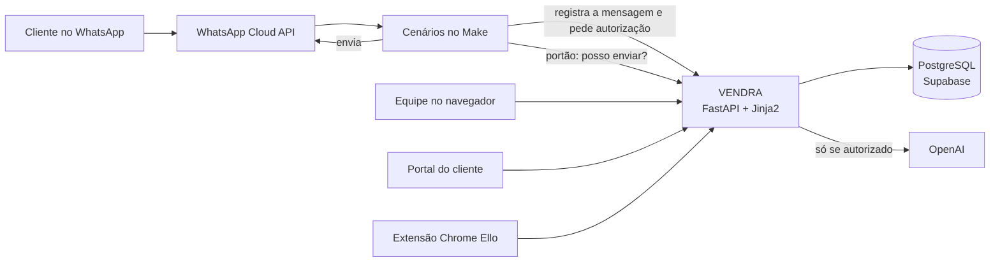
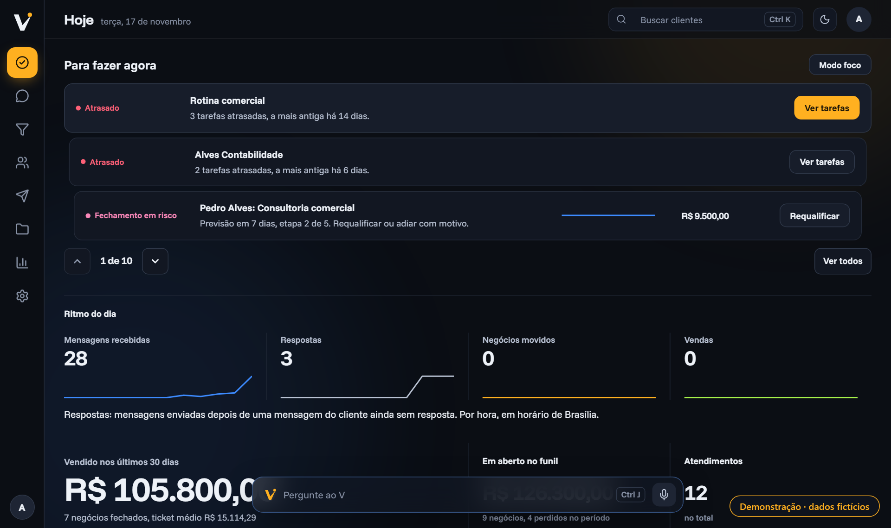
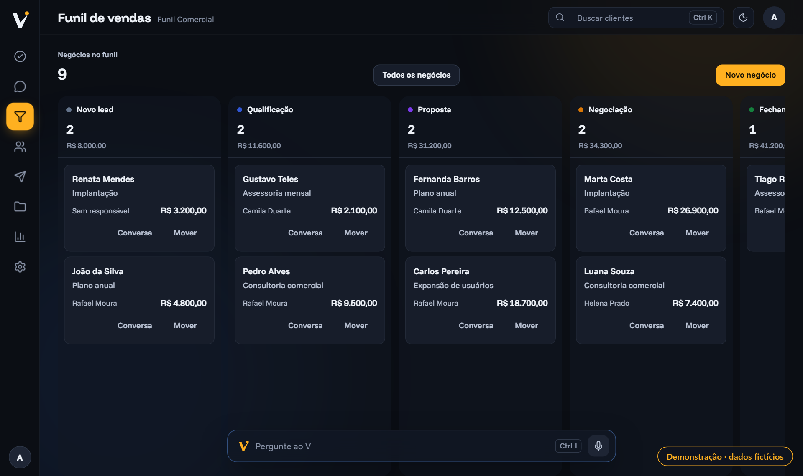
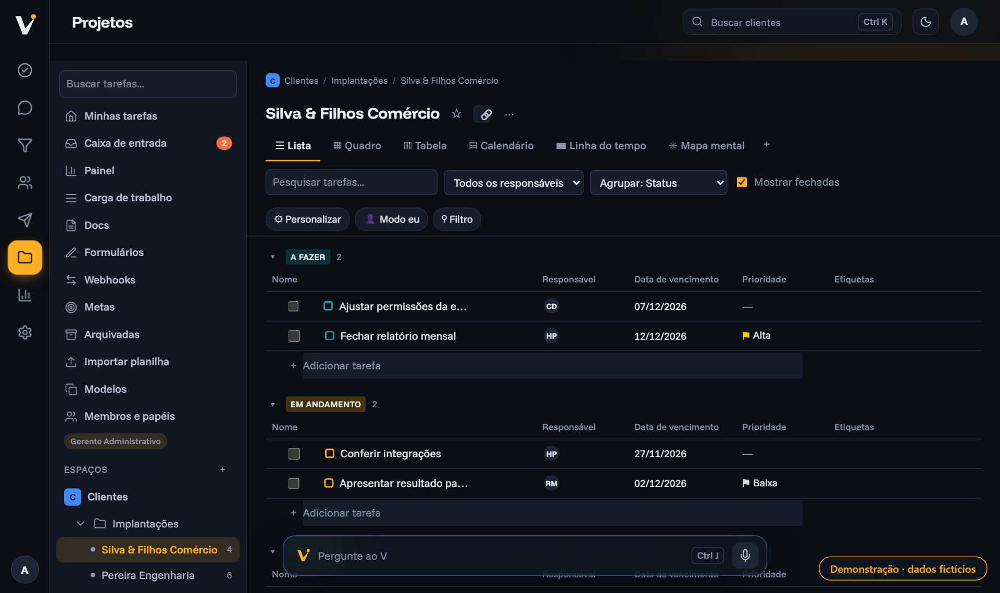
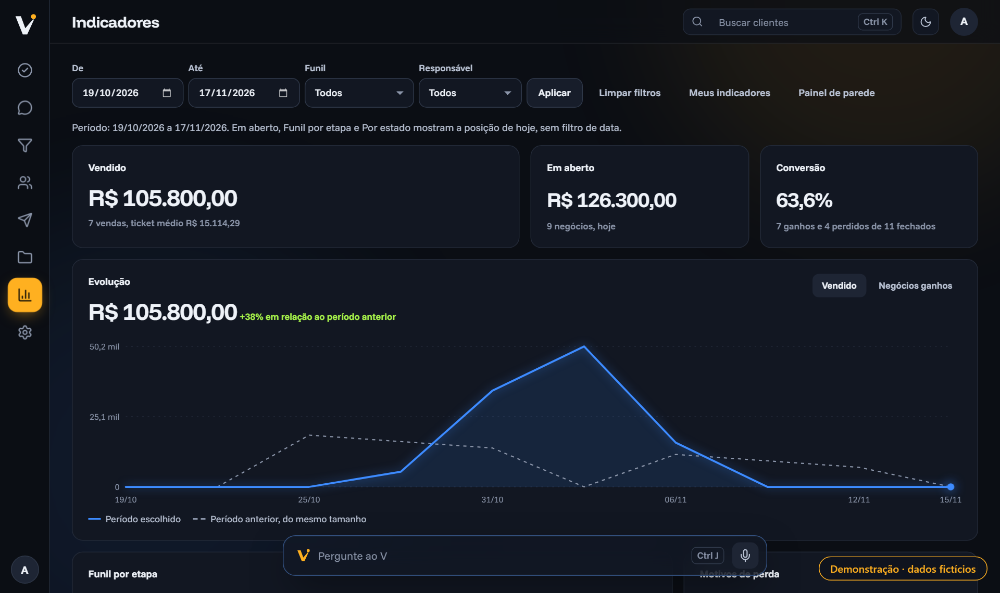

# VENDRA: estudo de caso

**O problema:** pequenas e médias empresas vendem pelo WhatsApp, mas o atendimento, os disparos, o funil e a entrega dos projetos ficam espalhados em ferramentas que não conversam. O VENDRA junta isso numa plataforma só, com IA ligada aos dados de cada empresa.

**O desafio técnico:** fazer isso funcionar com cliente real sem mandar mensagem duplicada, sem um cliente ver o dado de outro e sem a IA fazer o que a pessoa não pode fazer.

> O código do VENDRA é privado porque o produto está em uso. Este repositório documenta a arquitetura, as decisões e os problemas reais que apareceram. As telas são da versão de demonstração, que roda sem banco e só com dados fictícios.

## O que roda em produção

- Atendimento pelo WhatsApp com IA, que passa a conversa para uma pessoa quando precisa
- Disparos em lote com freio de segurança e follow-up só em dia útil
- Ligações pelo WhatsApp (Calling API da Meta)
- Funil, indicadores e gestão de projetos no estilo ClickUp
- Portal onde cada empresa cliente acompanha o próprio projeto
- Ello: extensão do Chrome que lê os sistemas que o cliente já usa, com a sessão dele
- V: agente de IA que consulta o sistema e propõe ações

## Números (repositório privado, até 16/11/2026)

| Item | Valor |
|---|---|
| Testes automatizados | mais de 1.200 (unittest + Playwright com clique real) |
| Telas | 105 |
| Código Python da aplicação | cerca de 43 mil linhas |
| Migrations versionadas | 58 |
| Commits entre 16/10 e 16/11/2026 | 170 |

## Arquitetura

| Camada | Tecnologia |
|---|---|
| Back-end | Python, FastAPI |
| Front-end | telas renderizadas no servidor com Jinja2, JavaScript e CSS próprios, sem framework; design system com tokens, tipografia e movimento; Three.js no mapa 3D |
| Dados | PostgreSQL no Supabase (funções RPC e Storage) |
| Integrações | WhatsApp Cloud API e Graph API da Meta, Make, webhooks assinados |
| IA | OpenAI: Chat Completions com function calling, Responses API com web_search, transcrição e voz |
| Extensão | Chrome Manifest V3 |
| Deploy e operação | Railway; backup diário e auditoria de envios pelo GitHub Actions |

## Decisões e problemas reais

1. [63 mensagens repetidas e o portão de envio](casos/01-mensagens-repetidas.md)
2. [Um cliente não pode ver o outro: 80 rotas testadas](casos/02-isolamento-do-portal.md)
3. [105 telas e nenhum framework de front-end](casos/03-front-end-sem-framework.md)
4. [Um agente de IA que não decide permissão](casos/04-agente-v.md)
5. [Programar com agentes de IA sem perder o controle](casos/05-processo-com-agentes.md)

## Telas da demonstração

| Hoje | Funil |
|---|---|
|  |  |

| Projetos | Indicadores |
|---|---|
|  |  |

## Próximos passos (planejados, ainda não existem)

- Diagnóstico de empresas com IA
- Análise dos números em tempo real
- Front-end com HTMX + Alpine.js, componentes Jinja, TypeScript e ECharts, quando a estrutura estabilizar

## Autor

Gean Bonni, desenvolvedor Python. [LinkedIn](https://www.linkedin.com/in/geanbonni)
